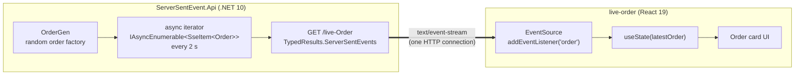
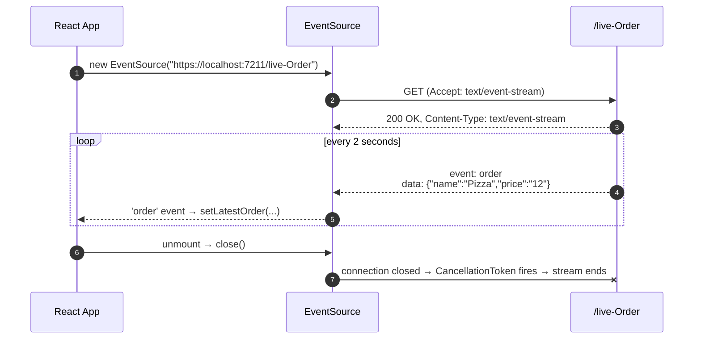

# Live Orders: Server-Sent Events with .NET 10 and React

> A real-time **live order feed** that pushes new orders from a **.NET 10 Minimal API** to a **React 19** dashboard using **Server-Sent Events (SSE)**, with no polling and no WebSocket server to run. It is a compact reference for building live dashboards, notifications and activity feeds.


---

## Table of contents

1. [Business overview](#1-business-overview)
2. [Features](#2-features)
3. [Architecture](#3-architecture)
4. [Why SSE?](#4-why-sse)
5. [Design patterns](#5-design-patterns)
6. [Technology stack](#6-technology-stack)
7. [Project structure](#7-project-structure)
8. [How it works](#8-how-it-works)
9. [Getting started](#9-getting-started)
10. [API reference](#10-api-reference)
11. [Development workflow](#11-development-workflow)
12. [Taking it to production](#12-taking-it-to-production)

---

## 1. Business overview

Restaurants, e-commerce back offices, logistics hubs and support desks all need screens that **update the moment something happens**: a new order, a status change, an alert. Refreshing the page or polling the server every few seconds wastes bandwidth and still feels slow.

This project shows how to stream events **from the server to the browser over a single, long-lived HTTP connection**. In the demo, the server creates a food order (Pizza, Burger, Pasta, Salad, Sushi) every 2 seconds, and a kitchen-style screen shows the latest order instantly.

---

## 2. Features

- **Real-time push.** Orders arrive as they happen, with no polling.
- **Native .NET 10 SSE.** Uses `TypedResults.ServerSentEvents` with `IAsyncEnumerable<SseItem<T>>`; no extra libraries.
- **Named events.** Each message is sent as event type `order`, so clients can listen for specific events.
- **Reconnect hint.** Every item tells the browser how long to wait before reconnecting (`ReconnectionInterval`).
- **Clean disconnects.** When the client goes away, the server stops the stream through a `CancellationToken`.
- **CORS** set up for the React dev servers (`localhost:3000`, `localhost:3001`).
- **React lifecycle.** The `EventSource` is opened in `useEffect` and closed on unmount or error.

---

## 3. Architecture



---

## 4. Why SSE?

| | Polling | **SSE** | WebSockets |
|---|---|---|---|
| Direction | Client → server | **Server → client** | Both ways |
| Transport | Repeated HTTP requests | **One HTTP response kept open** | Upgraded TCP connection |
| Auto-reconnect | Manual | **Built into the browser** | Manual |
| Proxy / firewall friendly | Yes | **Yes (plain HTTP)** | Sometimes blocked |
| Best for | Rare updates | **Feeds, dashboards, notifications** | Chat, games, collaboration |

When data only needs to flow **from server to client**, SSE is the simplest fit.

---

## 5. Design patterns

| Pattern | Where | Why |
|---|---|---|
| **Observer / publish-subscribe** | Server pushes, the browser `EventSource` subscribes to `order` | Clients react to events instead of asking for them. |
| **Async iterator (producer)** | `GetOrder(...)` with `yield return` | Produces an endless stream lazily, one item at a time. |
| **Cooperative cancellation** | `[EnumeratorCancellation] CancellationToken` | The stream stops cleanly when the client disconnects. |
| **Factory** | `OrderGen.CreateOrder()` | One place to create orders (later: replace with a real source). |
| **Immutable message** | `sealed record Order` | Messages can't change after they are sent. |
| **Effect + cleanup (React)** | `useEffect` returns `evtSource.close()` | No leaked connections when the component unmounts. |

---

## 6. Technology stack

| Layer | Technology |
|---|---|
| Backend | .NET 10, ASP.NET Core Minimal API, `System.Net.ServerSentEvents` |
| Frontend | React 19, Create React App (`react-scripts` 5), browser `EventSource` API |
| Testing (client) | Jest + React Testing Library |
| API docs | `Microsoft.AspNetCore.OpenApi` |

---

## 7. Project structure

```text
ServerSentEvent/
├── ServerSentEvent.Api/
│   ├── ServerSentEvent.Api.slnx
│   └── ServerSentEvent.Api/
│       ├── Gen/OrderGen.cs          # Order record + random order factory
│       ├── Program.cs               # CORS, SSE endpoint /live-Order
│       └── Properties/launchSettings.json
└── ServerSentEvent.Client/
    └── live-order/                  # React app
        ├── public/
        ├── src/
        │   ├── App.js               # EventSource subscription + order card
        │   └── App.css
        └── package.json
```

---

## 8. How it works



What travels on the wire (simplified):

```text
event: order
data: {"name":"Sushi","price":"18"}
retry: 60000

```

---

## 9. Getting started

### Prerequisites

| Tool | Version |
|---|---|
| .NET SDK | 10.x |
| Node.js | 18+ with npm |
| Dev HTTPS certificate | `dotnet dev-certs https --trust` |

### 1. Start the API

```bash
git clone https://github.com/tmadushan95/ServerSentEvent.git
cd ServerSentEvent/ServerSentEvent.Api
dotnet run --project ServerSentEvent.Api --launch-profile https
```

- HTTPS: `https://localhost:7211`
- HTTP: `http://localhost:5279`

Quick check from a terminal (`-N` turns off buffering so events show as they arrive):

```bash
curl -N -k https://localhost:7211/live-Order
```

### 2. Start the React client

```bash
cd ServerSentEvent/ServerSentEvent.Client/live-order
npm install
npm start
```

Open **http://localhost:3000**. After "Loading…", the latest order appears and changes every 2 seconds.

---

## 10. API reference

| Method | Route | Response | Description |
|---|---|---|---|
| `GET` | `/live-Order` | `text/event-stream` | Endless stream of `order` events, one every 2 seconds |

**Event payload**

```json
{ "name": "Burger", "price": "9" }
```

---

## 11. Development workflow

1. Branch: `git checkout -b feature/<name>`.
2. **Server:** add a new stream by mapping another endpoint that returns `TypedResults.ServerSentEvents(...)` with its own event name.
3. **Client:** subscribe with `evtSource.addEventListener("<event-name>", ...)` and keep the cleanup in `useEffect`.
4. Test with `curl -N` first, then in the browser (DevTools → Network → EventStream tab).
5. Commit and open a pull request to `main`.

---

## 12. Taking it to production

This is a **demonstration**. For real use, consider:

- [ ] Replace `OrderGen` with a real source (database change feed, message bus, `Channel<T>` fed by your order service)
- [ ] Broadcast to many clients from one producer (for example `System.Threading.Channels` + a hosted service)
- [ ] Support `Last-Event-ID` so reconnecting clients can catch up on missed events
- [ ] Add authentication (cookie or query-string token, since `EventSource` can't set headers)
- [ ] Move the API URL in `App.js` to an environment variable (`REACT_APP_API_URL`)
- [ ] Turn off response buffering at reverse proxies (for example `X-Accel-Buffering: no` for Nginx)

---

**Author:** [tmadushan95](https://github.com/tmadushan95)
